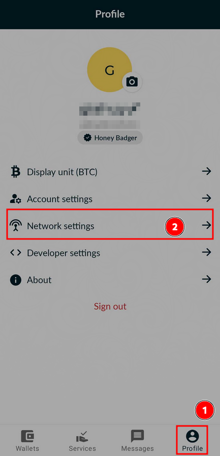
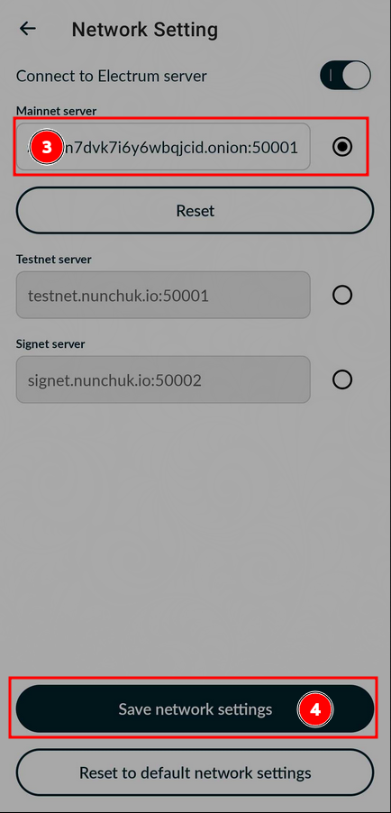
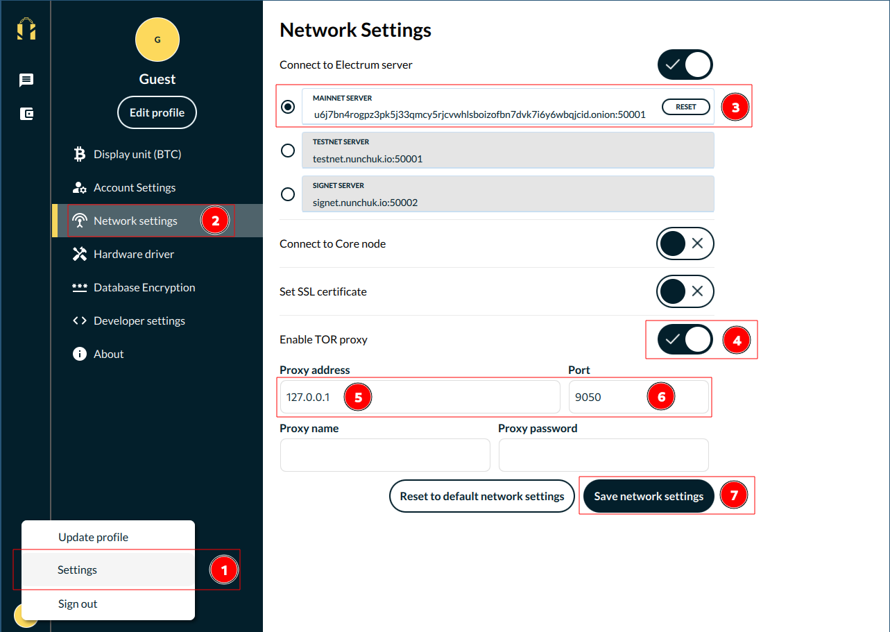

# Nunchuk Integration Setup

You will need to be running Tor on your device.  Refer to Start9's Tor guide:

https://start9.com/latest/user-manual/connecting/connecting-tor/tor-os/index

## Nunchuk mobile

**Note:** On Android, you will need to set up Nunchuk in VPN mode in Orbot.  Check the Android guide on the link above.

1. Open Nunchuk and select the Profile -> Network Settings

2. Enter your electrs Hostname and Port (found in your Embassy's electrs service page, under "Properties") into the "Mainnet server" field.

3. Save network settings then restart Nunchuk

## Nunchuk desktop

1. Open Nunchuk and go to Profile (bottom left icon) -> Settings -> Network Settings

1. Enter your electrs Hostname and Port (found in your Embassy's electrs service page, under "Properties") into the "MAINNET SERVER" field.

1. Enable "Use TOR Proxy" and enter `127.0.0.1` as the proxy address. Use port `9050` if you are running the Tor service, or `9150` if you are using Tor Browser. Keep the Tor service or Tor Browser running while using Nunchuk.

1. Save network settings then restart Nunchuk

